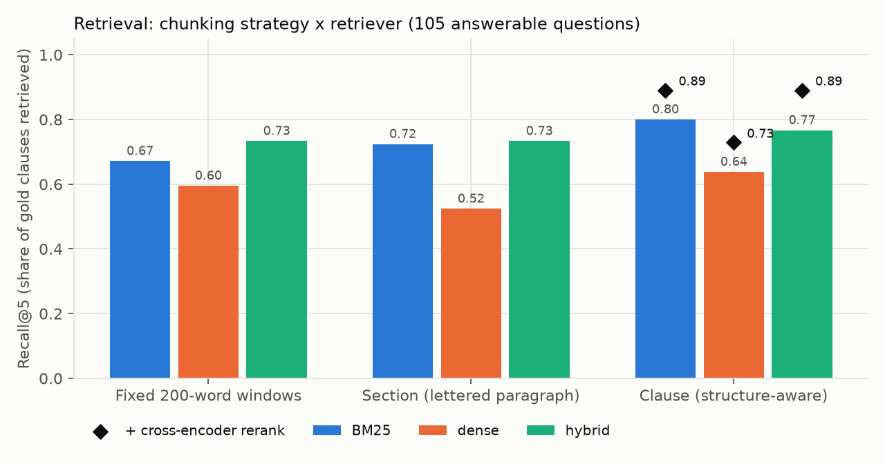
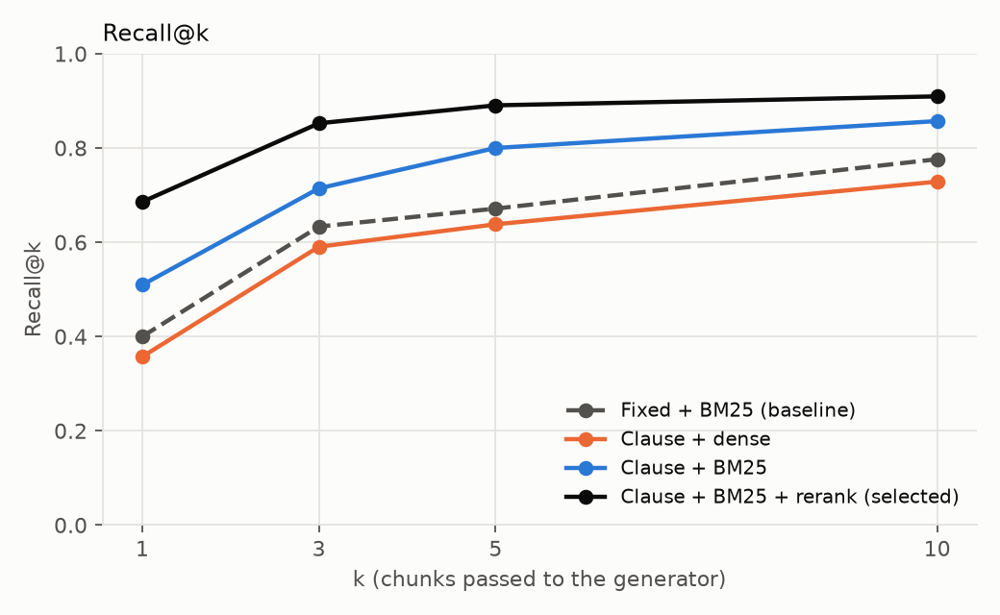
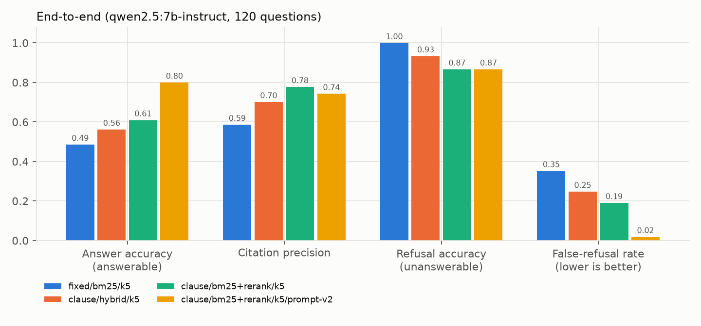

# insurance-policy-qa

**Question answering over real FEMA flood insurance policies. Every answer cites the exact clause and page, the system says "Not covered in the documents" when the policy doesn't answer the question, and a 120-question hand-built evaluation harness measures all of it.**

The corpus is five public FEMA documents: the three Standard Flood Insurance Policy forms (Dwelling, General Property, RCBAP) and two NFIP consumer guides. No synthetic data is used. All results below come from scripts in this repo, run on a single workstation, and the command that reproduces each one is listed.

## Results

The 120-question gold set has 105 answerable and 15 unanswerable questions, each with clause-level evidence labels ([criteria](evals/GOLD_SET.md)). A separate **25-question held-out set** was written later and used only once (see below). Generator: `qwen2.5:7b-instruct` (Ollama, temperature 0). Embeddings: `nomic-embed-text`. Raw outputs for every run are in [`evals/results/`](evals/results/), and the full tables are in [`evals/results/RESULTS.md`](evals/results/RESULTS.md).

### Headline (strict automated grading)

| Configuration | Retrieval recall@5 | Answer accuracy (105 answerable) | Citation precision | Refusal accuracy (15 unanswerable) | False-refusal rate |
|---|---|---|---|---|---|
| Baseline: fixed 200-word chunks + BM25, prompt v1 | 0.671 | 48.6% | 0.59 | 100% | 35.2% |
| Clause chunks + BM25 + cross-encoder rerank, prompt v1 | 0.890 | 61.0% | 0.78 | 86.7% | 19.0% |
| **Same + prompt v2 (shipped default)** | 0.890 | **80.0%** | 0.74 | 86.7% | **1.9%** |

- **Hand audit of the shipped configuration.** I read all 105 answerable answers. 77 are fully correct (**73.3%**), 16 reach the right bottom line but with incomplete or wrong reasoning, and 12 are wrong. The automated grader agrees with the human verdict on 89.5% of items and is slightly optimistic: 9 answers it passed were judged not fully correct, and 2 it failed were judged correct. Per-item verdicts are in [`evals/results/hand_audit_v2.csv`](evals/results/hand_audit_v2.csv).
- **Held-out check of the prompt change.** Prompt v2 was written *after* reading v1's failures on the gold set, so its gold-set score is optimistic. On the 25 held-out questions it improved answer accuracy from **35% to 65%** and cut false refusals from 55% to 10%. In exchange, it answered 1 of 5 unanswerable questions (refusal accuracy fell from 100% to 80%). The n is small, but the direction matches the gold set.
- **Separating the two effects.** Prompt v2 on the naive baseline retrieval scores 69.5%, so the prompt is worth about +21 points and better retrieval about +10 more (69.5% → 80.0%).
- **Grounding.** 3.9% of answered questions contain a number that appears in none of the cited excerpts. No answer cited a clause it wasn't shown, because the model can only cite excerpt numbers.
- **Cost per query.** About 1,320 prompt tokens and 52 completion tokens. The marginal cost is zero on local hardware. On a hosted API it is about 1.37M tokens per 1,000 queries, priced at your provider's rate.



### Retrieval ablation (105 answerable questions)

| Chunking | BM25 R@5 | Dense R@5 | Hybrid (RRF) R@5 | + rerank (clause only) R@5 / MRR@10 |
|---|---|---|---|---|
| Fixed 200-word windows | 0.671 | 0.595 | 0.733 | - |
| Section (lettered paragraph) | 0.724 | 0.524 | 0.733 | - |
| **Clause (structure-aware)** | **0.800** | 0.638 | 0.767 | BM25 **0.890 / 0.783**, hybrid 0.890 / 0.772, dense 0.729 / 0.657 |

What the grid shows:

1. **Structure-aware chunking helps every retriever.** BM25 R@5 rises from 0.671 to 0.800, and dense from 0.595 to 0.638.
2. **Dense retrieval was the weakest retriever on this corpus.** The three SFIP forms are near-duplicates, and the embedding model can't separate "the jewelry limit in the Dwelling Form" from the same clause in the RCBAP. Exact policy vocabulary ("proof of loss", "$2,500", "RCBAP") favours BM25.
3. **Hybrid fusion helped weak chunkings but not clause chunks.** On clause chunks, RRF with the weaker dense ranking scored *below* BM25 alone (0.767 vs 0.800). I report that instead of assuming hybrid is always better.
4. **The cross-encoder reranker gave the largest single gain** (BM25 R@1 0.509 → 0.686). Its cost is CPU time; see latency below.



### End-to-end ablation (prompt v1 unless noted)

| Config | Answer acc. | Citation precision | Refusal acc. | False refusals | Prompt tokens |
|---|---|---|---|---|---|
| fixed / BM25 / k=5 | 48.6% | 0.59 | 100% | 35.2% | 1,633 |
| clause / hybrid / k=5 | 56.2% | 0.70 | 93.3% | 24.8% | 1,253 |
| clause / hybrid + rerank / k=5 | 59.0% | 0.80 | 86.7% | 22.9% | 1,255 |
| clause / BM25 + rerank / k=3 | 59.0% | 0.84 | 86.7% | 20.0% | 829 |
| clause / BM25 + rerank / k=5 | 61.0% | 0.78 | 86.7% | 19.0% | 1,229 |
| clause / BM25 + rerank / k=8 | 62.9% | 0.72 | 86.7% | 19.0% | 1,814 |
| fixed / BM25 / k=5, **prompt v2** | 69.5% | 0.58 | 93.3% | 13.3% | 1,724 |
| **clause / BM25 + rerank / k=5, prompt v2** | **80.0%** | 0.74 | 86.7% | 1.9% | 1,320 |

- Raising k trades citation precision for a little recall. k=8 adds 2 correct answers and 47% more prompt tokens, while k=3 keeps 97% of the k=5 accuracy with 33% fewer tokens.
- Differences of 1-2 questions (about 1-2 points) are within noise at n=105.



### Latency (shared workstation, see caveat)

Retrieval only, clause chunks, 30 questions, **no caches** (`python -m evals.bench_latency`):

| Retriever | p50 | p95 |
|---|---|---|
| BM25 | 0.5 ms | 0.8 ms |
| Dense (Ollama embedding call) | 46.5 ms | 62.7 ms |
| Hybrid (RRF) | 49.2 ms | 72.3 ms |
| BM25 + cross-encoder rerank (20 candidates, CPU) | 1,720 ms | 2,485 ms |
| Hybrid + rerank | 1,868 ms | 2,340 ms |

In the eval run, the shipped configuration had an end-to-end p50 of **3.4 s** (p95 6.5 s). That run had reranker scores cached, so a cold query adds about 1.7 s, for an estimated ~5 s p50 uncached. Generation runs on a shared RTX 4070 Ti with about 1.3k prompt tokens. Caveat: these runs shared the machine with other CPU- and GPU-heavy jobs, and the reranker ran on CPU, so treat the numbers as an upper bound rather than a benchmark. Reranker scores are cached on disk across eval runs, which is why the reranked rows in `RESULTS.md` look faster than the uncached numbers above.

## Failure analysis: what the evaluation found

**1. The refusal sentence collided with insurance language (the biggest finding).** Prompt v1 told the model to answer *"Not covered in the documents."* when it couldn't answer. In insurance, "not covered" means *excluded*. Asked "Is my swimming pool covered?", the model saw the exclusion and answered with the refusal sentence. With the best retrieval, **12 of 19 exclusion questions were refused**, even though most had the right clause in context. Prompt v2 moves refusal into the JSON flag and states that "an exclusion IS an answer". Exclusion-question refusals dropped to 2 of 19, and exclusion accuracy rose from 26% to 63%. The user-facing refusal text is unchanged, and the API still returns "Not covered in the documents."

**2. Near-duplicate clauses across forms.** The Dwelling Form, General Property Form, and RCBAP share most of their wording. Typical errors:
- q083 says the Dwelling Form is primary over the RCBAP (it's the reverse).
- q071 describes the RCBAP's three-method loss settlement for the GP form.
- q108 applies the $250,000 per-unit condo cap to a commercial building.

Form-name headers in every chunk and a prompt rule reduced these errors but did not remove them. Next step: metadata filtering by form when the user's policy type is known.

**3. False premises.** q103 asks about the Dwelling Form's "$10,000 pollution coverage" (that coverage exists only in the GP form). The model accepted the premise in every configuration. Trick-question accuracy is 5/7 with v2.

**4. Exceptions inside exclusions.** Rules like "repairs must be finished first *if* the cost exceeds $1,000 or 5%" (q037) and "you may assign the policy *except when*..." (q049) were inverted or garbled by the 7B model even with the right clause retrieved.

**5. Grader limits.** Regex key facts are strict about wording and can be fooled by a matching token. q083 passed because it contains the word "primary". The hand audit quantifies this (89.5% agreement), and both kinds of error are listed in `hand_audit_v2.csv`.

Reproduce the failure listing: `python -m evals.failures "evals/results/gen_clause_bm25-rerank_k5_prompt-v2.jsonl"`.


## Architecture

```mermaid
flowchart LR
    A[FEMA PDFs<br/>scripts/download_corpus.py] --> B[Clause parser<br/>Article > Letter > Number<br/>ipqa/ingest.py]
    B --> C[(segments.jsonl<br/>698 clause/section units)]
    C --> D[Chunker<br/>clause | section | fixed]
    D --> E[BM25 index]
    D -. ablation .-> F[nomic-embed-text vectors<br/>dense / hybrid RRF]
    Q[Question] --> E
    E --> H[Cross-encoder rerank<br/>MiniLM-L12, top-20 to top-5]
    F -.-> H
    H --> I[Numbered excerpts + JSON prompt v2]
    I --> J[qwen2.5:7b-instruct<br/>any OpenAI-compatible endpoint]
    J --> K[Answer + excerpt numbers<br/>mapped to clause ids and pages]
    K --> L[FastAPI + web UI]
    K --> M[Eval harness<br/>evals/]
```

Solid path = shipped configuration (chosen by the evaluation). Dotted = built, evaluated, and selectable with `IPQA_RETRIEVER=dense|hybrid`.

**Design choices:**

- **Structure-aware parsing.** The SFIP is numbered (`V. EXCLUSIONS > D. > 5.`). The parser rebuilds that tree, so every chunk knows its clause id (`DF:V.D.5`) and PDF page. A marker counts only if it continues the expected sequence, which stops stray lines like "U.S. Army..." from opening a new clause.
- **Clause chunks carry their context.** Each chunk is prefixed with its form name, its clause path, and its parent's lead-in sentence. "4. Sinkholes;" becomes "[Dwelling Form] V. EXCLUSIONS > C. We do not insure for loss... caused directly by earth movement... 4. Sinkholes;".
- **Refusal is a flag, not a phrase.** The model returns `"answerable": false` and the API shows "Not covered in the documents." (why this matters: see Failure analysis #1).
- **Citations can't be invented.** The model cites excerpt *numbers* only, and code maps them to clause ids and pages. Out-of-range numbers are dropped.
- **Any OpenAI-compatible LLM.** Base URL, model, and key are environment variables (`IPQA_LLM_*`), and CI uses a deterministic mock.

## Run it (5 commands)

```bash
python -m venv .venv && . .venv/bin/activate        # Windows: .venv\Scripts\activate
pip install -r requirements.txt
python scripts/download_corpus.py && python scripts/build_index.py
ollama pull nomic-embed-text && ollama pull qwen2.5:7b-instruct
uvicorn app.main:app --port 8000                      # http://127.0.0.1:8000
```

Reproduce the evaluation:

```bash
python -m evals.run_retrieval                                            # retrieval ablation grid
python -m evals.run_generation --chunking fixed  --retriever bm25   --k 5 # baseline
python -m evals.run_generation --chunking clause --retriever hybrid --k 5
python -m evals.run_generation --chunking clause --retriever bm25   --rerank --k 5 --prompt v2   # shipped config
python -m evals.run_generation --chunking clause --retriever bm25   --rerank --k 5 --prompt v2 --gold holdout_set.yaml
python -m evals.bench_latency
python -m evals.make_report                                              # charts + RESULTS.md
pytest -q                                                                # 26 tests, no network
```

Docker: `docker compose -f deploy/docker-compose.yml up -d --build` (API + Ollama). It is not deployed anywhere.

## Repository layout

| Path | What |
|---|---|
| `ipqa/ingest.py` | PDF to clause segments (policy forms) / heading sections (guides) |
| `ipqa/chunking.py` | `fixed`, `section`, `clause` chunkers plus clause-coverage bookkeeping |
| `ipqa/retrieval.py` | BM25, dense (Ollama embeddings, disk-cached), RRF hybrid, cross-encoder reranker |
| `ipqa/qa.py`, `ipqa/llm.py` | Prompt, JSON parsing, citation mapping; OpenAI-compatible + mock clients |
| `ipqa/metrics.py` | recall@k, MRR, answer/citation/refusal scoring, unsupported-number check |
| `evals/gold_set.yaml` | 120 hand-written questions (criteria in `evals/GOLD_SET.md`) |
| `evals/results/` | Every run's raw answers (`gen_*.jsonl`), summaries (CSV), `RESULTS.md` |
| `app/` | FastAPI service (`/api/ask`, `/api/health`, `/api/documents`) + single-page UI, per-IP rate limit |
| `deploy/` | Dockerfile + docker-compose (API + Ollama) |
| `docs/INTERVIEW_GUIDE.md` | Design walkthrough, insurance primer, interview Q&A |

## Data sources and licenses

| Id | Document | Edition | Source |
|---|---|---|---|
| DF | SFIP Dwelling Form (F-122) | Oct 2021 | [fema.gov](https://www.fema.gov/sites/default/files/documents/fema_F-122-Dwelling-SFIP_2021.pdf) |
| GP | SFIP General Property Form (F-123) | Oct 2021 | [fema.gov](https://www.fema.gov/sites/default/files/documents/fema_F-123-general-property-SFIP_2021.pdf) |
| RC | SFIP Residential Condominium Building Association Policy (F-144) | Oct 2021 | [fema.gov](https://www.fema.gov/sites/default/files/documents/fema_F-144-RCBAP-SFIP_2021.pdf) |
| SC | NFIP Summary of Coverage (P-2144) | Dec 2023 | [agents.floodsmart.gov](https://agents.floodsmart.gov/sites/default/files/media/document/2025-07/fema-nfip-summary-coverage-brochure-12-2023.pdf) |
| CH | NFIP Claims Handbook (F-687) | Aug 2024 | [agents.floodsmart.gov](https://agents.floodsmart.gov/sites/default/files/media/document/2025-07/fema-nfip-claims-handbook-08-2024.pdf) |

- **License.** All five documents are works of the U.S. federal government (FEMA) and are not subject to copyright in the United States ([17 U.S.C. 105](https://www.law.cornell.edu/uscode/text/17/105)).
- **What's in the repo.** The PDFs are not committed. `scripts/download_corpus.py` fetches them with a descriptive User-Agent and a 1 s delay between requests, then records their SHA-256 hashes in `data/manifest.json`. The parsed clause text (`data/processed/segments.jsonl`) is committed so tests and CI run offline.
- **Retrieval date.** All documents were retrieved 2026-10-10.
- **Models.** `nomic-embed-text` (Apache-2.0), `qwen2.5:7b-instruct` (Apache-2.0), and `Xenova/ms-marco-MiniLM-L-12-v2` (Apache-2.0).
- **Not advice.** This is a demonstration system. It is not legal or insurance advice, and the policy's own text controls.

## Limitations

- **Gold set.** One author wrote it from the documents, and no second annotator checked it, so inter-annotator agreement is unmeasured. The prompt v2 numbers on the gold set are optimistic because v2 was designed from failures on it. The 25-question held-out set is the unbiased check, and it is small.
- **Grading.** The headline uses deterministic regex and clause-id checks. A hand audit of the shipped configuration found the grader about 6.7 points optimistic (80.0% strict vs 73.3% hand-audited fully correct). Only that configuration was hand-audited.
- **One generator.** Only `qwen2.5:7b-instruct` was evaluated, and no hosted-model comparison was run (no API accounts were used). The client is OpenAI-compatible, so a comparison is a configuration change.
- **Reranker ablation scope.** Reranking was ablated on clause chunks only, because CPU cross-encoder inference on the shared machine was slow (see latency).
- **Corpus scope and edition.** The corpus is five FEMA flood documents (2021 SFIP editions, downloaded 2026-10-10). Homeowners and auto questions are correctly refused because they are out of scope. FEMA's newer guides can differ from the 2021 forms: the 2024 handbook gives six years to complete ICC work, while the 2021 Dwelling Form says two.
- **Not production.** The app has a per-IP rate limit and no auth, and it is not deployed. This is a demonstration, not insurance advice.

## What I'd do next

1. Add **metadata filtering by policy form** (ask "which form?" or infer it), which targets the largest remaining error class.
2. Add a **retrieval-confidence refusal gate** on reranker scores, so the LLM isn't the only gatekeeper. That should recover the unanswerable-question regressions.
3. Run a **second annotator plus a dev/test split** for the gold set, then an LLM-judge cross-check calibrated against the hand audit.
4. Compare against a larger or hosted model on accuracy, latency, and cost per 1k queries using the same harness.
5. Move the cross-encoder to GPU and re-measure latency on a dedicated machine.

